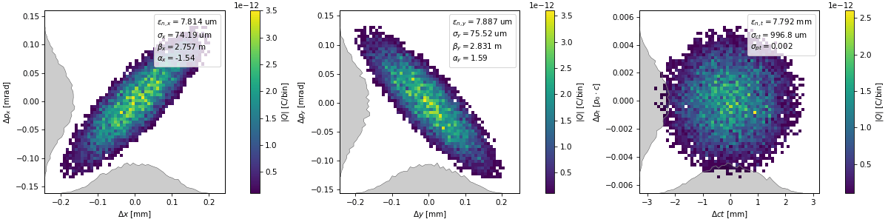

.. _dataanalysis:

Data Analysis
=============

.. _dataanalysis-monitor:

Beam Monitor
------------

ImpactX provides a zero-sized beam monitor element that can be placed in lattices to output the particle beam at multiple positions in a lattice.
Output is written in the standardized, `open particle-mesh data schema (openPMD) <https://www.openPMD.org>`__ and is `compatible with many codes and data analysis frameworks <https://github.com/openPMD/openPMD-projects>`__.

For data analysis of openPMD data, see examples of `many supported tools, Python libraries and frameworks <https://openpmd-api.readthedocs.io/en/latest/analysis/viewer.html>`__.
`Exporting data to ASCII <https://openpmd-api.readthedocs.io/en/latest/analysis/pandas.html#openpmd-to-ascii>`__ is possible, too.

See also `WarpX' documentation on openPMD <https://warpx.readthedocs.io/en/latest/dataanalysis/formats.html>`__.

At each monitor, the output for every particle in the beam is provided.
This includes the 6 canonical phase space variables (x [m], px, y[m], py, t[m], pt), where each coordinate is measured relative to the reference particle, in the local moving frame.
See the section :ref:`Coordinates and Units <theory-coordinates-and-units>` for additional details.

.. _dataanalysis-monitor-refparticle:

Additional Beam Attributes
""""""""""""""""""""""""""

We add the following additional attributes on the openPMD ``beam`` species at the monitor position.

Reference particle:

* ``beta_ref`` reference particle normalized velocity :math:`\beta = v/c`
* ``gamma_ref`` reference particle Lorentz factor :math:`\gamma = 1/\sqrt{1-\beta^2}`
* ``beta_gamma_ref`` reference particle momentum normalized to rest mass :math:`\beta\gamma = p/(mc)`
* ``s_ref`` integrated orbit path length, in meters
* ``x_ref`` horizontal position x, in meters
* ``y_ref`` vertical position y, in meters
* ``z_ref`` longitudinal position z, in meters
* ``t_ref`` clock time * c, in meters
* ``px_ref`` momentum in x, normalized to mass*c, :math:`p_x = \gamma \beta_x`
* ``py_ref`` momentum in y, normalized to mass*c, :math:`p_y = \gamma \beta_y`
* ``pz_ref`` momentum in z, normalized to mass*c, :math:`p_z = \gamma \beta_z`
* ``pt_ref`` energy, normalized by rest energy, :math:`p_t = -\gamma`
* ``gyromagnetic_anomaly_ref`` `anomalous magnetic moment <https://en.wikipedia.org/wiki/Anomalous_magnetic_dipole_moment>`__, unitless
* ``mass_ref`` reference rest mass, in kg
* ``charge_ref`` reference charge, in C

Bunch properties: all properties listed in :ref:`Reduced Beam Characteristics <dataanalysis-beam-characteristics>`.

Example to print the integrated orbit path length ``s`` at each beam monitor position:

.. code-block:: python

   import openpmd_api as io

   series = io.Series("diags/openPMD/monitor.h5", io.Access.read_only)

   for k_i, i in series.iterations.items():
       beam = i.particles["beam"]
       s_ref = beam.get_attribute("s_ref")
       print(f"step {k_i:>3}: s_ref={s_ref}")

.. _dataanalysis-python-inmemory:

In-Memory Python Access
-----------------------

In addition to the file-based openPMD output above, ImpactX can be steered from a Python script
and the beam particles, the reference particle, and the space-charge fields can be inspected or
modified **live** during a run. This is the right approach for custom in-situ diagnostics,
turn-by-turn feedback, AI/ML coupling, or any analysis that you don't want to round-trip through (slow) filesystem disks.

* :ref:`usage-howto-python-extend`: the overall pattern, plus the callback surfaces
  (``sim.hook[...]`` and the :py:class:`~impactx.elements.Programmable` element).
  For analysis, prefer ``sim.hook[...]`` with ``sim.beam``: the ``Programmable``
  element hands you particles in per-tile chunks and is intended for custom
  particle pushes, not observation.
* :ref:`usage-howto-python-particle-data`: accessing ``sim.beam`` as a pandas DataFrame
  (via :py:meth:`~impactx.ParticleContainer.to_df`) or iterating over particle tiles for
  high-performance access.
* :ref:`usage-howto-python-field-data`: accessing the space-charge fields
  (:py:meth:`~impactx.ImpactX.rho`, :py:meth:`~impactx.ImpactX.phi`,
  :py:meth:`~impactx.ImpactX.space_charge_field`) and their lifetime caveats.

.. _dataanalysis-beam-characteristics:

Reduced Beam Characteristics
----------------------------

ImpactX calculates reduced beam characteristics based on the beam moments during runtime.
These include averaged positions and momenta, as well as beam emittances and Courant-Snyder (Twiss) parameters.
For computing beam moments (as elsewhere), positions and momenta are given as deviations with respect to the reference particle (see :ref:`Coordinates and Units <theory-coordinates-and-units>`).

The reduced beam characteristics are stored with the output of the beam monitor element.
They are also calculated before, after, and during each step of the simulation.
If :pp:param:`diag.slice_step_diagnostics` is enabled, they will also be calculated during each slice of each beamline element.

The code writes out the values in an ASCII file prefixed ``reduced_beam_characteristics`` containing the follow columns:

* ``step``
    Iteration within the simulation
* ``period``
    Current period (turn or cycle) for periodic lattices (unit: dimensionless)
* ``s``
    Reference particle coordinate ``s`` (unit: meter)
* ``mean/min/max_x``, ``mean/min/max_y``, ``mean/min/max_t``
    Average / minimum / maximum particle displacement with respect to the reference particle in the dimensions of ``x``, ``y`` (transverse coordinates, unit: meter), and ``t`` (normalized time difference :math:`ct`, unit: meter)
* ``sigma_x``, ``sigma_y``, ``sigma_t``
    Standard deviation of the particle positions (speed of light times time delay for ``t``) (unit: meter)
* ``mean/min/max_px``, ``mean/min/max_py``, ``mean/min/max_pt``
    Average / minimum / maximum particle momentum deviation from the reference particle momentum, divided by the magnitude of the reference particle momentum (unit: dimensionless, radians for transverse momenta)
* ``sigma_px``, ``sigma_py``, ``sigma_pt``
    Standard deviation of the particle momentum deviations (energy difference for ``pt``) normalized by the magnitude of the reference particle momentum (unit: dimensionless)
* ``emittance_x``, ``emittance_y``, ``emittance_t``
    Unnormalized rms beam emittances (unit: meter)
* ``alpha_x``, ``alpha_y``, ``alpha_t``
    Courant-Snyder (Twiss) alpha (unit: dimensionless).  Transverse Twiss functions are calculated after removing correlations with particle energy.
* ``beta_x``, ``beta_y``, ``beta_t``
    Courant-Snyder (Twiss) beta (unit: meter).  Transverse Twiss functions are calculated after removing correlations with particle energy.
* ``dispersion_x``, ``dispersion_y``
    Horizontal and vertical dispersion (unit: meter)
* ``dispersion_px``, ``dispersion_py``
    Derivative of horizontal and vertical dispersion (unit: dimensionless)
* ``emittance_xn``, ``emittance_yn``, ``emittance_tn``
    Normalized rms beam emittances (unit: meter)
* ``emittance_1``, ``emittance_2``, ``emittance_3``
    Normalized rms beam eigenemittances (aka mode emittances) (unit: meter)
    These three diagnostics are written optionally if the flag eigenemittances = True.
* ``charge_C``
    Total beam charge (unit: Coulomb)
* ``mean_sx``, ``mean_sy``, ``mean_sz``
    Mean of the particle spin vector (unit: dimensionless).  This is also known as the polarization vector.  This diagnostic is written only if spin tracking is on (algo.spin = True).
* ``sigma_sx``, ``sigma_sy``, ``sigma_sz``
    Standard deviation of the three spin components (unit: dimensionless).  This diagnostic is written only if spin tracking is on (algo.spin = True).

Quantities that a beam does not define are written as ``nan``.
The ``step``, ``period`` and ``s`` columns describe the position in the lattice and are always written.
The Courant-Snyder (Twiss) ``alpha`` and ``beta`` of a plane are ratios to its rms emittance, and are undefined wherever that emittance vanishes: for a single particle, for a cold plane, or longitudinally for a beam without energy spread.
For zero-weight test beams, added with a bunch charge of zero, there is no total weight to normalize by: every weighted moment is undefined and ``charge_C`` is zero, while the unweighted ``min`` and ``max`` still report the extent of the beam.
For a simulation whose beam is loaded in a :py:class:`~impactx.elements.Source` element instead of prior to tracking, the beam is empty until that element is reached: every diagnostic before it reports ``nan`` for all moments, minima and maxima included, and zero for ``charge_C``.

.. _dataanalysis-plot:

Interactive Analysis
--------------------

When steering ImpactX from Python, one can at any point visualize the beam phase space with:

.. code-block:: python

   import matplotlib.pyplot as plt

   from impactx import ImpactX, RefPart, distribution, elements

   sim = ImpactX()

   # ... setup and simulate ...

   pc = sim.particle_container()

   fig = pc.plot_phasespace()

   # note: figure data available on MPI rank zero
   if fig is not None:
       fig.savefig("phase_space.png")
       plt.show()

   In situ visualization of the beam phase space projections.

.. _dataanalysis-insitu:

In Situ Visualization with Ascent
---------------------------------

With `Ascent <https://ascent.readthedocs.io>`__, ImpactX visualizes the particle beam while it is tracked, over all MPI ranks.
ImpactX passes the particle arrays to Ascent without copies.
This needs ImpactX built with ``-DImpactX_ASCENT=ON``.

The beam is shown in its coordinates relative to the reference particle at fixed :math:`s`.
Two presets cover common views:

* ``"beam3d"``: Ascent renders the particles in :math:`x`, :math:`y` and :math:`t`, colored by a particle component, e.g., ``momentum_t``.
* ``"phasespace"``: Ascent sums the charge per bin of the phase space projections; the figure is the one of ``plot_phasespace()``.

A single view, as a matplotlib figure:

.. code-block:: python

   import matplotlib.pyplot as plt

   fig = sim.beam.plot_ascent("beam3d", color="momentum_t")

   # note: figure data available on MPI rank zero
   if fig is not None:
       fig.savefig("beam3d.png")
       plt.show()

An animation while the beam is tracked, with one frame after each lattice element:

.. code-block:: python

   from impactx import insitu

   anim = insitu.Animation("phasespace", num_bins=64)
   sim.hook["after_element"] = anim

   sim.track_particles()

   anim.save("phasespace.gif", fps=4)  # or .mp4, .html, or a directory of PNG images
   anim.show()  # in a window
   anim  # in Jupyter: an interactive animation

Instead of a preset, own `Ascent actions <https://ascent.readthedocs.io/en/latest/Actions/index.html>`__ can be passed as ``actions=[...]``, e.g., starting from :py:func:`impactx.insitu.ascent_actions`.
See :ref:`usage-python-insitu` for all options and :ref:`examples-fodo` for an example.

.. note::

   On GPUs, Ascent 0.9.6 renders the ``"beam3d"`` images on the GPU.
   It reads particles in managed memory (``amrex.the_arena_is_managed = 1``) in place.
   For particles in device memory, the default of ImpactX, Ascent copies the particle components that it renders, on the GPU, for each image.

   Ascent bins on the host (CPU), on a single thread.
   On GPUs, the ``"phasespace"`` preset needs the particles in managed memory, and the binned particle components move to the host and back for each frame.
   For large beams, :py:meth:`~impactx.ParticleContainer.plot_phasespace` is faster.

   Ascent keeps the results of the ``"phasespace"`` binnings of all frames in memory, about :math:`3 \times 8` bytes per bin and frame.
