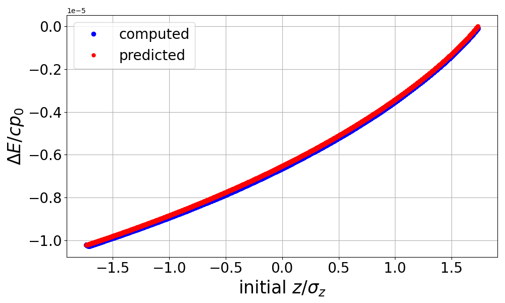

.. _examples-user-wake-kick:

Momentum Kick in a 1D User-Specified Longitudinal Wake Model
============================================================

The test compares the energy change due to a short-range wakefield in a TESLA 9-cell (1.3 GHz) RF cavity against the analytical result for the case of a bunch with
a uniform current profile.

A single slice is used, resulting in a single wakefield kick.  The bunch is initialized with zero momentum spread and zero transverse size, to avoid dynamical
evolution during the half-step in the dipole field before the wakefield kick is applied.

In this test, the final momentum of every particle is compared against its predicted value.  Both the maximum error and its rms value over the bunch population are
returned.  Both values must be zero within a small tolerance.

Run
---

This example can be run as:

* **Python** script: ``python3 run_user_wake_kick.py``

For `MPI-parallel <https://www.mpi-forum.org>`__ runs, prefix these lines with ``mpiexec -n 4 ...`` or ``srun -n 4 ...``, depending on the system.

.. tab-set::

   .. tab-item:: Python: Script

       .. literalinclude:: run_user_wake_kick.py
          :language: python3
          :caption: You can copy this file from ``examples/wake_csr_kick/run_user_wake_kick.py``.

Analyze
-------

We run the following script to analyze correctness:

.. dropdown:: Script ``analysis_user_wake_kick.py``

   .. literalinclude:: analysis_user_wake_kick.py
      :language: python3
      :caption: You can copy this file from ``examples/wake_csr_kick/analysis_user_wake_kick.py``.

Visualize
---------

You can run the following script to visualize the energy kick as a function of head-tail position along the bunch:

.. dropdown:: Script ``plot_user_wake_kick.py``

   .. literalinclude:: plot_user_wake_kick.py
      :language: python3
      :caption: You can copy this file from ``examples/wake_csr_kick/plot_user_wake_kick.py``.

   Short-range wakefield generated by a longitudinally uniform bunch in a TESLA 9-cell RF cavity (1D model).
